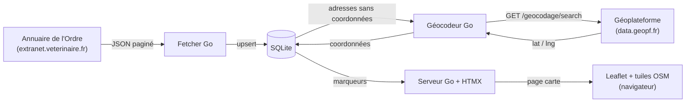

# Vet-Tracker

   

> Web app (Go + HTMX + SQLite) to track internship applications to veterinary clinics: periodic sync of the official directory, status tracking, notes and map view.

Application web de suivi de ma recherche de stage en clinique vétérinaire. Elle récupère automatiquement les cliniques depuis l'annuaire officiel de l'Ordre des Vétérinaires, les géocode via les API publiques de l'État, puis me permet de suivre chaque démarche (statut, notes) dans une interface légère, avec une vue carte.

## Ce que ce projet démontre

- **Intégration d'API tierces** : consommation d'une API d'annuaire (JSON paginé), d'un service de géocodage public et d'une bibliothèque cartographique côté client.
- **Backend Go idiomatique** : routeur Chi, erreurs enrobées (`%w`), contextes et timeouts HTTP, client découplé et testable.
- **Persistance maîtrisée** : SQLite, migrations Goose versionnées, requêtes typées générées par sqlc (pas de SQL inline dans les handlers).
- **Frontend sobre** : rendu serveur (`html/template`) et HTMX, sans framework JavaScript ni étape de build front.
- **Robustesse** : synchronisation idempotente (upsert sans écraser le suivi), tolérance aux pannes du géocodage, arrêt propre en cas de limitation de débit.

## Intégrations externes



### Annuaire de l'Ordre des Vétérinaires

Source des cliniques (`backend/internal/fetcher/`).

- Endpoint : `GET {VET_API_BASE_URL}/api/directories/search-veterinaries-for-care` (l'API est exposée par l'extranet de l'Ordre, sans authentification).
- Paramètres : `departmentId` (département **70**), `limit` (15) et `page` (indexée à 0).
- La réponse contient `pagination` (`page`, `total`, `limit`) et une liste de vétérinaires, chacun avec un ou plusieurs **DPE** (domiciles professionnels d'exercice). Un DPE correspond à une clinique, identifiée par son `ordinalNumber` (ex. `503737-1`).
- Le client parcourt toutes les pages en recalculant leur nombre à partir de `pagination.total`, puis aplatit vétérinaires → DPE en conservant l'identité du praticien.
- Timeout configurable (`VET_API_TIMEOUT_SECONDS`), statuts HTTP non-2xx remontés avec un extrait du corps pour le diagnostic.
- Les cliniques sont **upsertées par identifiant externe** : relancer la synchronisation met à jour les coordonnées de contact sans toucher aux statuts ni aux notes.
- Déclenchement au démarrage (si la base est vide ou datée de plus de 12 h) puis toutes les 24 h.

### Géocodage : data.gouv.fr (Géoplateforme)

Conversion des adresses en coordonnées (`backend/internal/geocoder/`).

- Service : API de géocodage de la Géoplateforme (`https://data.geopf.fr/geocodage/search`), le service national d'adresses utilisé par adresse.data.gouv.fr, sans clé d'API.
- La requête combine `q` (voie), `postcode` et `city`, avec `type=housenumber` et `limit=1` pour obtenir une localisation précise au numéro.
- La réponse GeoJSON (`[longitude, latitude]`) est convertie en latitude/longitude puis enregistrée dans `clinics`.
- Gestion des cas limites : aucune correspondance, réponse HTTP 429 (le traitement s'arrête proprement) ou autre erreur, avec un bilan final (géocodées, introuvables, en échec).
- Deux modes : le programme `cmd/geocoding` traite par lot les cliniques sans coordonnées, et l'ajout manuel d'une clinique la géocode immédiatement. Un échec de géocodage n'empêche jamais la création.
- Un `User-Agent` explicite identifie l'application auprès du service.

### Carte : Leaflet et OpenStreetMap

Visualisation des cliniques (`backend/internal/templates/`).

- [Leaflet](https://leafletjs.com/) 1.9.4 est chargé dans le layout de base ; les tuiles proviennent d'OpenStreetMap, avec l'attribution requise.
- Le serveur injecte les cliniques géocodées dans le template sous forme de données JSON ; le script crée un marqueur par clinique.
- La couleur du marqueur reflète le statut de suivi (non contactée, contactée, à relancer, acceptée, refusée…).
- Au clic, la fiche de la clinique est chargée via HTMX dans le popup : statut et notes sont modifiables directement depuis la carte. Le marqueur est mis à jour ou retiré selon l'action (changement de statut, masquage), sans rechargement.
## Stack et structure

- Backend : Go, routeur Chi, SQLite (`modernc.org/sqlite`) et migrations Goose.
- Interface : templates `html/template` en `.gohtml`, HTMX et CSS servi localement. La carte est rendue par les templates dédiés.
- Les requêtes SQL sont dans `backend/sql/query/`; `backend/internal/database/` contient le code généré par sqlc.

```text
Vet-Tracker/
├── backend/
│   ├── cmd/server/           # Serveur web et synchronisation périodique
│   ├── cmd/geocoding/        # Géocodage des cliniques sans coordonnées
│   ├── internal/api/         # Routes, handlers et accès aux données de l'interface
│   ├── internal/database/    # Code sqlc généré
│   ├── internal/fetcher/     # Client de l'annuaire vétérinaire
│   ├── internal/templates/   # Layouts, pages et fragments HTML
│   ├── sql/migrations/       # Migrations Goose embarquées dans le binaire
│   ├── sql/query/            # Requêtes source sqlc
│   └── static/               # HTMX et styles
└── doc.MD
```

## Prérequis et démarrage local

Le module Go déclare Go **1.26.0** (`backend/go.mod`). Depuis la racine du dépôt :

```powershell
cd backend
$env:DEV="true"
go run ./cmd/server
```

Ouvrir <http://localhost:8080>. `DEV=true` recharge les templates à chaque requête et active le journal HTTP de Chi. Sans cette variable, les templates sont chargés au démarrage.

Le serveur crée ou met à niveau le schéma SQLite au démarrage. Il ne crée pas de cliniques de démonstration : si la base ne contient pas encore de données synchronisées, il lance une synchronisation de l'annuaire en arrière-plan.

Commandes utiles, depuis `backend/` :

```powershell
go test ./...
go build -o vet-tracker.exe ./cmd/server
go run ./cmd/geocoding
```

Le serveur et le géocodeur utilisent le même `DB_PATH`. Lancez-les depuis le dossier `backend` si vous souhaitez utiliser les chemins par défaut.

## Données et synchronisation

Les migrations Goose sont embarquées dans `backend/sql/migrations/` et appliquées automatiquement au démarrage du serveur.

- `clinics` contient les coordonnées de contact et d'adresse, l'identifiant externe, la source (`fetched` ou `manual`), la visibilité, le statut de suivi et les coordonnées géographiques.
- `notes` contient les notes liées aux cliniques.
- Le statut est stocké directement dans `clinics.track_status`; la table historique `tracking_entries` est supprimée par la migration `0005_tracking_in_clinic.sql`.
- Les cliniques masquées restent en base mais ne figurent plus dans les vues visibles.

Voir « Intégrations externes » pour le détail de la synchronisation de l'annuaire et du géocodage.

## Configuration

| Variable                  | Valeur par défaut                 | Utilisation                                                                                  |
| ------------------------- | --------------------------------- | -------------------------------------------------------------------------------------------- |
| `PORT`                    | `8080`                            | Port HTTP du serveur                                                                         |
| `DB_PATH`                 | `./data.db`                       | Fichier de base SQLite                                                                       |
| `LOG_PATH`                | `./vet-tracker.log`               | Fichier de journal du serveur                                                                |
| `VET_API_BASE_URL`        | `https://extranet.veterinaire.fr` | URL de base de l'API de l'annuaire                                                           |
| `VET_API_TIMEOUT_SECONDS` | `20`                              | Timeout des requêtes à l'annuaire; une valeur invalide ou non positive revient à 20 secondes |
| `DEV`                     | non définie                       | `true` active le rechargement des templates et le middleware de journal HTTP                 |

Le géocodeur respecte `DB_PATH` et `LOG_PATH`; son fichier de journal par défaut est `./geocoding.log`.

Exemple PowerShell avec une base persistante distincte :

```powershell
cd backend
$env:DB_PATH=".\data.db"
$env:LOG_PATH=".\vet-tracker.log"
go run ./cmd/server
```

## Licence

[MIT](LICENSE)